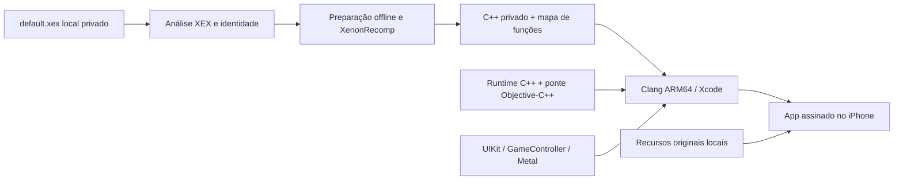

# Arquitetura inicial

Objetivo: recompilar previamente o PowerPC para C++ e compilar esse resultado com
Clang para ARM64. No iPhone, executar funções nativas vinculadas ao app, usando
serviços restritos de compatibilidade, backend Metal e dados originais locais.
Não gerar código executável no dispositivo. Esta arquitetura ainda não executa o jogo.

A seta de preparação é um contrato de integração: não significa que a geração do
Storm já ocorreu. Não há configuração de funções ou executável real disponível.

## Limites dos módulos

| Módulo | Implementação inicial | Contrato e próximo trabalho |
| --- | --- | --- |
| A — análise | Python, stdlib, JSON, limites e identidade | Metadados XEX2 e inventário PPC raw separado; reconstruir PE, imports/exports, funções completas, tabelas de salto |
| B — CPU/AOT | Tradutor sintético → C++ e contexto pequeno | Integrar XenonRecomp fixado; ABI guest, FPR/FPSCR/CR/XER, VMX128, indirect calls e atomics |
| C — runtime | C++17, API C estável, memória BE, allocator, imports, relógio, conteúdo local e input | Implementar serviços xboxkrnl/XAM reais somente após inventário; threads/TLS/eventos/save e proteção virtual pendentes |
| D — gráficos | MetalKit e shader MSL de diagnóstico no app | Parser/interceptação Xenos, tradução shaders, texturas tiled, EDRAM, depth/stencil e resolve pendentes |
| E — áudio | Fila PCM SPSC limitada com overflow/underrun e testes | Decodificador XMA e saída Core Audio/AVAudioEngine, sincronização e interrupções pendentes |
| F — controles | Estado host normalizado + GameController/touch no app | Validar mapeamento específico e combinação de comandos em gameplay |
| G — aplicativo | UIKit, Objective-C++, Files, validação, configurações e logs | Testar Xcode/simulador/aparelho; iniciar runtime retorna falta de imagem AOT |

`runtime/storm_runtime.h` evita expor C++ ao frontend. O dono do runtime deve parar
antes de destruir. O app fornece caminho de dados no próprio sandbox e input
normalizado. Erros de lançamento são estados reais, nunca sucesso provisório.

Memória inicial é um buffer limitado e verificado para testes. Não é uma reserva
virtual de 4 GiB nem modelo completo de MMU. A estratégia de XenonRecomp usa base
contígua guest; será necessário escolher entre reserva virtual compatível com iOS
ou adaptação explícita do emissor. Não decidir por alocação física de 4 GiB.
Não solicitar entitlements de memória sem medir necessidade e disponibilidade.

Imports são indexados por biblioteca e ordinal, sem stubs que retornem sucesso.
Ainda não há contratos reais xboxkrnl/XAM. Exceções C++ permanecem dentro da ponte
C; erros são expostos via status/mensagem. Registrar PC guest em futuros dispatches.

## Sincronização e representação

Guest é big-endian, host ARM64 little-endian. Loads/stores usam conversões explícitas
no protótipo. Testes devem separar lanes VMX, alinhamento, NaNs/denormais, flags e
reservas atômicas. O vetor inicial só testa soma modular e XOR; não cobre VMX128.
Não habilitar múltiplas threads guest antes de revisar `lwsync`, `sync`,
`lwarx/stwcx.` e granularidade de reservas no código gerado.

Nenhum opcode desconhecido é descartado no tradutor sintético. O XenonRecomp
upstream ainda exige auditoria dos traps/defaults; não confundir compilação sem
erro com cobertura completa de controle de fluxo.

## Gráficos, áudio e desempenho

Metal é requisito nativo. MoltenVK do SpeedBreaker é referência de integração,
sem adoção automática. Começar por dados próprios para geometria, textura, blend,
depth e render target; só depois comparar shaders/cenas do jogo. Não substituir
Xenos por um triângulo fictício. O diagnóstico tem nome explícito no app.

Áudio exigirá demux/decodificação XMA e saída PCM. Nenhum som sintetizado é usado
como prova do áudio do jogo. Preservar seleção japonesa apenas se o conjunto local
contiver os dados compatíveis. FFmpeg depende de auditoria de configuração/licença.

Perfis de 30/60 Hz e escala de renderização do diagnóstico são controles de
infraestrutura, não FPS do jogo. A escala adaptativa por tempo GPU implementada no diagnóstico ainda precisa de
teste Apple. Cache de shaders do jogo, streaming assíncrono, pressão de memória
e budgets térmicos precisam de implementação/medições reais. Registrar CPU/GPU, percentis de frame time, memória,
thermalState, resolução, build e duração de cada teste no iPhone 15 Pro.
